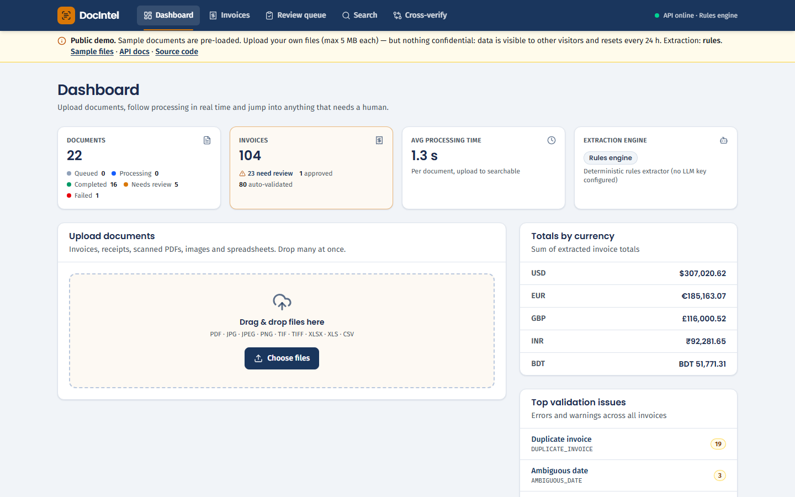
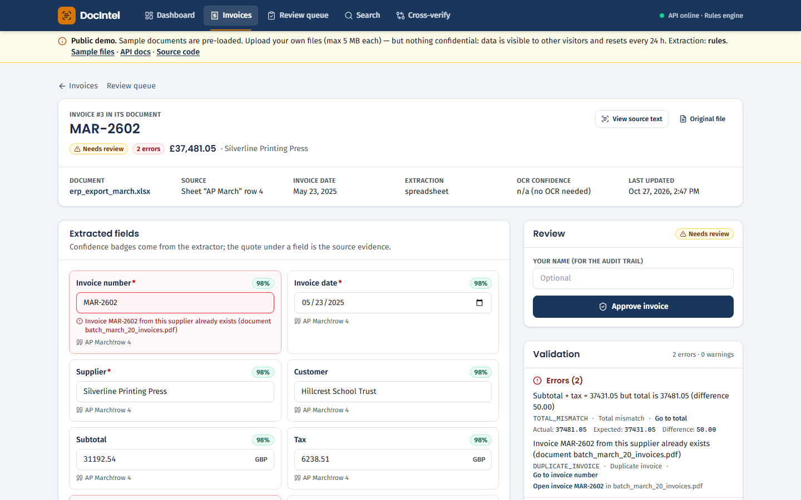
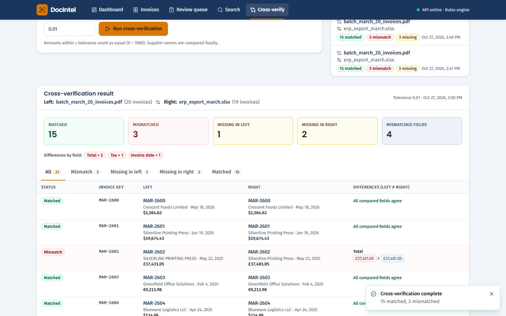
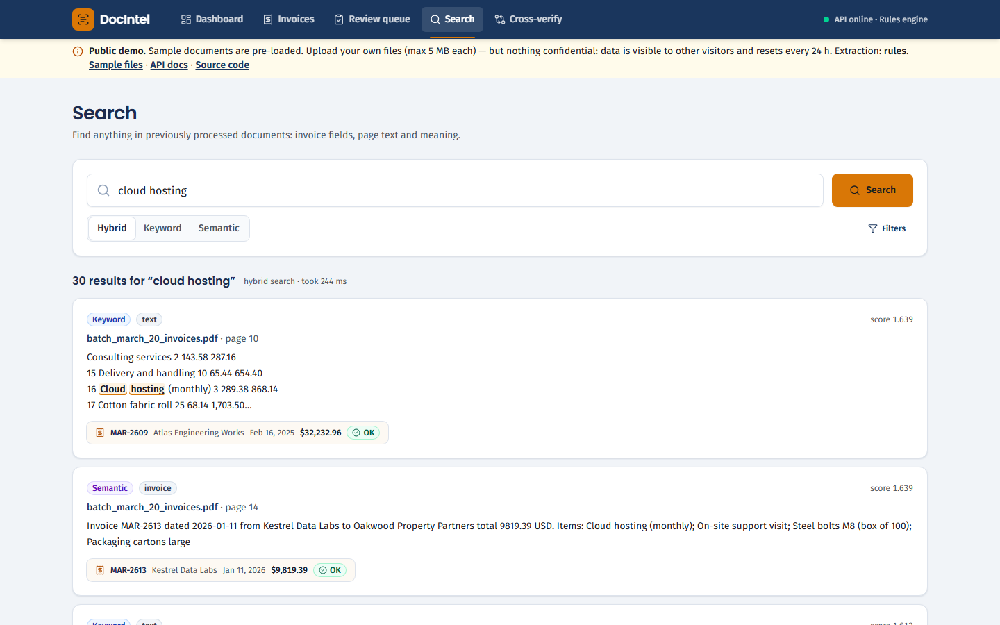

# DocIntel: AI-powered document intelligence

> **Disclaimer:** this is a technical-assessment project, provided as-is and not production-certified. It was built **with AI assistance** (Claude Code), as disclosed in [docs/AI_DISCLOSURE.md](docs/AI_DISCLOSURE.md). All sample documents are **synthetic and fictitious**. Evaluation numbers were measured on that synthetic data with the rules-based extractor. See [DISCLAIMER.md](DISCLAIMER.md).

DocIntel turns invoices, receipts, scanned PDFs, photos and spreadsheets into validated, searchable structured data.

It accepts **PDF, JPG, PNG, TIFF, XLSX, XLS and CSV** files (one at a time or hundreds at once, including 1000-page PDFs). For each file it:

1. extracts the text: the PDF text layer when there is one, otherwise OCR with image clean-up; spreadsheets are parsed directly;
2. splits batch PDFs into individual invoices;
3. extracts the **invoice number, date, supplier, customer, subtotal, tax, total, currency and line items** as JSON, with a confidence score and supporting evidence for each field, and without inventing values;
4. validates the results: missing fields, arithmetic, duplicates, dates, OCR quality;
5. indexes everything for keyword, semantic and hybrid search.

People then review flagged records, correct values with a full audit trail, and cross-verify one document against another (PDF ↔ PDF, PDF ↔ Excel).

## Live demo and walkthrough

* **Live demo: https://docintel-9qdz.onrender.com** (no login, sample documents pre-loaded, API docs at [/api/docs](https://docintel-9qdz.onrender.com/api/docs)). Free hosting: after ~15 idle minutes the first visit shows a loading page for about a minute while the server wakes up.
* **Video walkthrough (captioned, 2 min):** [docs/walkthrough/walkthrough.webm](docs/walkthrough/walkthrough.webm)
* **Run the full system locally in one command:** see [Quick start](#quick-start).

| Dashboard | Review & correct |
|---|---|
|  |  |
| **Cross-verify PDF vs Excel** | **Search** |
|  |  |

## Measured results

From [docs/evaluation-report.md](docs/evaluation-report.md): a real end-to-end run through the API on a labeled dataset of 70 documents and 136 invoices (synthetic; rules extractor).

| Metric | Result |
|---|---|
| Field-level extraction accuracy (8 fields) | **99.3%** (digital PDF & spreadsheets 100%, images 98.2%, scans 92.5%) |
| Hallucinated values | **0** |
| Document success rate / failure rate | **100% / 0%** (64 valid files); 7/7 corrupted or unsupported files handled |
| Invoice detection, including splitting a 20-invoice batch PDF | 100% (136/136), 0 spurious |
| Planted validation errors detected | 100% (incl. duplicate across a PDF and a rescanned PNG) |
| PDF ↔ Excel cross-verification | matches the planted 15 / 3 / 2 / 1 exactly |
| 1000-page digital PDF | results in **67 s** (15 pages/s); search index built asynchronously |
| Tests | 104 passed, 90% line coverage ([docs/test-results.md](docs/test-results.md)) |

| | |
|---|---|
| **How to use (step by step)** | [docs/USER_GUIDE.md](docs/USER_GUIDE.md) |
| Architecture & design decisions | [docs/architecture.md](docs/architecture.md) |
| Database schema (ER diagram + DDL) | [docs/database-schema.md](docs/database-schema.md), [docs/schema.sql](docs/schema.sql) |
| API reference | [docs/api.md](docs/api.md) · live OpenAPI at `http://localhost:8000/api/docs` |
| Evaluation report (measured) | [docs/evaluation-report.md](docs/evaluation-report.md) |
| Test results | [docs/test-results.md](docs/test-results.md) |
| Walkthrough recording | [docs/walkthrough/](docs/walkthrough/) |
| AI prompts & AI-assistance disclosure | [docs/AI_DISCLOSURE.md](docs/AI_DISCLOSURE.md) |

## Quick start

Requirements: Docker Desktop (or Docker Engine + Compose v2). About 4 GB of free RAM for the containers. Nothing else needs to be installed on the host.

```bash
git clone <this repo> docintel && cd docintel
cp .env.example .env
# set API_KEY to a random string; optionally set ANTHROPIC_API_KEY to enable Claude extraction
docker compose up -d --build
```

| Service | URL |
|---|---|
| Web app | http://localhost:3000 |
| REST API + Swagger UI | http://localhost:8000/api/docs (click *Authorize*, paste `API_KEY`), or http://localhost:3000/api/docs through the web proxy (no key needed) |

The first build takes a few minutes (Tesseract, Python wheels, and the embedding model is baked into the image). Database migrations run automatically when the API starts.

**Try it:** drag a few files from `eval/dataset/` (digital PDFs, scans, photos, spreadsheets, even the corrupted ones) onto the dashboard and watch them process.

### How to use, in short

1. **Upload** files on the Dashboard; many at once and mixed formats are fine.
2. **Watch** live progress: queued → processing → completed / needs review / failed (with a Reprocess button).
3. **Inspect** a document: the invoices found, the extracted text per page, the processing history and the original file.
4. **Review** flagged invoices in the *Review queue*: see each field's confidence and evidence plus the validation issues, correct values (every change is audited), then approve.
5. **Search** with filters or plain-language queries (keyword / semantic / hybrid).
6. **Cross-verify** two documents, e.g. a supplier PDF batch vs. an ERP Excel export, and see matched, mismatched and missing invoices.

The full walkthrough with screenshots-level detail and API examples is in [docs/USER_GUIDE.md](docs/USER_GUIDE.md).

### Extraction provider

| `EXTRACTION_PROVIDER` | Behaviour |
|---|---|
| `auto` (default) | Claude if `ANTHROPIC_API_KEY` is set, otherwise rules |
| `anthropic` | Claude (`LLM_MODEL`, default `claude-opus-5-5`; `LLM_EFFORT`) with schema-constrained output, evidence, a grounding check and a rules cross-check. Falls back to rules per document on API errors. |
| `rules` | Deterministic layout-aware extractor: no external calls, zero cost. |

## Running the tests and the evaluation

```bash
./scripts/run-tests.sh          # pytest (104 tests) in the backend image, against a separate test database
./scripts/run-eval.sh           # regenerate the labeled dataset, process it end to end, write docs/evaluation-report.md
./scripts/run-eval.sh --stress  # also time a 1000-page digital PDF and a 100-page scanned PDF
```

On Windows, run these from Git Bash. `run-eval.sh` resets (deletes) all documents in the running stack before it starts.

## Repository layout

```
backend/
  app/
    api/            REST routers: documents, invoices, search, reconciliations, jobs, stats
    pipeline/       detect, pdf, ocr, images, spreadsheet, layout, segment, processor (orchestration)
    extraction/     rules extractor, Claude extractor + prompts, grounding, spreadsheet mapper, normalisation
    validation/     business validation rules
    search/         embeddings (local bge-small) + keyword / semantic / hybrid search
    services/       invoice persistence + duplicate detection, cross-verification
    worker/         Celery app and task
  alembic/          database migrations
  tests/            pytest suite (unit + API end-to-end + failure scenarios)
frontend/           Next.js 16 app (App Router, Tailwind 4) with a server-side API proxy
eval/               dataset generator, labels, evaluation runner, report renderer, results
docs/               architecture, schema, API, evaluation, tests, AI disclosure, walkthrough
docker-compose.yml  db (Postgres+pgvector) · redis · api · worker · web
```

## Feature checklist (assignment mapping)

| Task | Where |
|---|---|
| **1. Document processing:** multiple files; PDF text layer; OCR for scans/images; spreadsheets; multi-page PDFs; multiple sheets; poor image quality; corrupted files | `pipeline/` (detect, pdf, ocr, images, spreadsheet), `POST /api/documents` |
| **2. AI extraction:** all 9 fields as JSON, no invented values | `extraction/llm.py` + `prompts.py` (Claude, structured output), `grounding.py`, `rules.py` |
| **3. Validation:** missing fields, incorrect numbers, duplicates, subtotal/tax/lines/total consistency, manual-review flag | `validation/rules.py`, `services/invoices.py` |
| **4. Backend API:** uploads, status, results, search, corrections, failed-job reprocessing, background processing | `api/`, `worker/` ([docs/api.md](docs/api.md)) |
| **5. Database & search:** metadata, text, results, errors, history; keyword filtering + semantic search | `models.py`, `search/`, [docs/database-schema.md](docs/database-schema.md) |
| **6. Frontend:** upload, progress, inspect, validation errors, corrections, search | `frontend/` |
| **7. Testing & evaluation:** automated tests; accuracy, processing time, success and failure rate | `backend/tests/`, `eval/`, [docs/evaluation-report.md](docs/evaluation-report.md) |
| **Scenario:** PDF↔PDF and PDF↔Excel cross-verification | `services/reconcile.py`, `POST /api/reconciliations`, *Cross-verify* page |

## Configuration

All settings are environment variables (see `.env.example` and `backend/app/config.py`). The main ones:

| Variable | Default | Purpose |
|---|---|---|
| `API_KEY` | (required) | Shared secret between the web proxy and the API (`API_KEYS` accepts a comma-separated list for rotation) |
| `ANTHROPIC_API_KEY` | empty | Enables Claude extraction |
| `WORKER_CONCURRENCY` | 2 | Documents processed in parallel per worker container |
| `OCR_WORKERS` | 3 | Parallel Tesseract processes per document |
| `MAX_UPLOAD_MB` / `MAX_PDF_PAGES` | 100 / 5000 | Input limits |
| `RATE_LIMIT_PER_MINUTE` | 600 | Per API key / IP |

Scale horizontally with `docker compose up -d --scale worker=4`.

## Deployment options

| | Full system (`docker-compose.yml`) | Single container (`deploy/container/`, `render.yaml`) |
|---|---|---|
| Use | Production-like: local machine, VM, Kubernetes | Free/small hosts, e.g. the public demo on Render |
| Processing | Background Celery workers + Redis, horizontally scalable | Inside the upload request, one document at a time |
| Search index | Async task on its own queue | Inline (semantic search off below ~1 GB RAM; falls back to keyword) |
| Files | Shared volume | Stored in Postgres (stateless instances) |
| Database | Bundled Postgres + pgvector | External Postgres + pgvector (Render, Neon, ...) |

**Public demo on Render (free, no credit card):** sign in to Render with GitHub, then open
`https://render.com/deploy?repo=https://github.com/piyaldeb/ai-document-intelligence` and click **Deploy Blueprint**. On
first start the container migrates the database and loads the sample documents; it refreshes them when they are older
than a day. Free-plan limits: 512 MB RAM / 0.1 CPU, sleeps after 15 idle minutes, the free database expires after 30 days.
Measured on a 512 MB / 0.1 CPU replica: digital PDFs 2 s, a CSV with 10 invoices 3 s, a photo 36 s, a 2-page scan 69 s,
no out-of-memory events.

## Known limitations and next steps

* Handwriting and very poor photos are beyond Tesseract. The OCR step is pluggable, so a hosted OCR or vision model (e.g. sending page images to Claude) could cover those pages.
* The evaluation dataset is synthetic. Before relying on the accuracy numbers in production, label a sample of real documents and re-run `eval/run_eval.py`.
* Authentication is a service-level API key. A multi-user deployment would add SSO/OIDC and per-user roles (reviewer vs. approver); the audit trail already records who made each change.
* File storage is a Docker volume. Swap in S3/MinIO behind `app/storage.py` for multi-host deployments.
