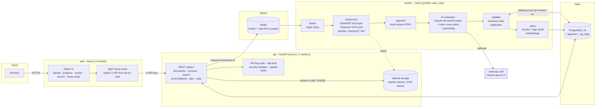

# Architecture

## System overview

## Processing pipeline

| Stage | What happens | Scaling / failure behaviour |
|---|---|---|
| **Upload** (`POST /api/documents`) | Each file is streamed to disk in 1 MiB chunks while its SHA-256 is computed; the extension allow-list and magic bytes are checked; a `documents` row is created; the job is enqueued. Returns `202` with one result per file. | No file is held in memory; size and file-count limits; an identical file re-upload is linked via `duplicate_of_id`. |
| **detect** | File type is determined from content (`%PDF`, PNG/JPEG/TIFF signatures, OLE2 for XLS, ZIP + `xl/workbook.xml` for XLSX). | A mismatched or damaged file fails with `CORRUPTED_FILE` / `UNSUPPORTED_FILE_TYPE`. |
| **extract_text** | **PDF:** words from the text layer are rebuilt into layout text (columns kept apart by 2+ spaces). Pages without a usable text layer (scanned pages, broken font encodings) are rendered at 300 DPI and OCR'd. **Images:** every TIFF frame is OCR'd. **Spreadsheets:** every sheet is parsed, the header row is detected (it may sit below title rows), CSV encoding and delimiter are sniffed and malformed rows are skipped and counted. | OCR runs in a bounded thread pool (each Tesseract call is a subprocess, so the work spreads across cores). Rendering stays sequential (PyMuPDF is not thread-safe) with back-pressure of 2× workers, so memory is bounded on 1000-page files. One bad page never fails the document. |
| **OCR quality** | A cheap pass runs first (contrast stretch). If confidence is below 78, an enhanced pass runs (projection-profile deskew, median denoise, CLAHE, adaptive threshold, speck removal). If still weak, Tesseract OSD fixes 90/180/270° rotation. The pass with the most confidently read words wins. | Per-page confidence is stored; low confidence raises `LOW_OCR_QUALITY` for review. Truncated JPEGs are partially recovered with a warning. |
| **segment** | Large PDFs are usually batches of many invoices. A new segment starts on "Page 1 of N", on a change of invoice number, or on a new invoice title after the previous segment printed its total. Spreadsheet registers and line-level exports map directly to invoice records; form-style sheets fall back to text extraction. | Linear in page count, using cheap regex signals only. |
| **ai_extraction** | Each segment's text goes to Claude with a JSON-schema-constrained output (`messages.parse` + Pydantic). The model must copy an evidence snippet for every field and return `null` rather than guess. Every returned value is **grounded**: an identifier, amount, date, currency or name not found in the source text is discarded and recorded as rejected. Confidence is calibrated against an independent rules extractor. Without an API key the rules extractor is used alone. | Segments run concurrently (`LLM_MAX_CONCURRENCY`). The SDK retries 429/5xx; persistent LLM errors fall back to rules with a note. Server-side refusal fallbacks are enabled. |
| **validate** | Rules: missing fields, numeric sanity, subtotal + tax = total, Σ line items = subtotal, qty × unit = amount, tax-rate sanity, dates, currency, duplicates (same supplier + number, or same supplier/date/total), low confidence, ungrounded values, OCR quality. | A Postgres advisory lock per normalized invoice number serializes concurrent workers, so duplicates are detected even when both copies process at once. Commits happen in batches of 200 invoices. |
| **index** | Each invoice summary and the page text chunks (900 chars, 150 overlap) are embedded locally with `BAAI/bge-small-en-v1.5` (ONNX, CPU) into `chunks.embedding` (HNSW cosine index). | No document text leaves the deployment for indexing. Capped at 5000 chunks per document. |
| **finalize** | Status becomes `completed`, or `needs_review` if any invoice or document-level issue needs a human. Total processing time is recorded. | Every stage writes `processing_events` (start, end, duration, message, attempt). |

## Reliability

* **Idempotent jobs.** A run first deletes the previous attempt's pages, invoices, issues and chunks, so reprocessing (`POST /documents/{id}/reprocess`, `POST /jobs/retry-failed`) is always safe.
* **At-least-once delivery.** Celery uses `acks_late` and `reject_on_worker_lost`, so a worker crash requeues the job. `prefetch_multiplier=1` keeps long OCR jobs from piling onto one worker. `max-tasks-per-child` recycles processes.
* **Typed failures.** `CORRUPTED_FILE`, `ENCRYPTED_FILE`, `EMPTY_DOCUMENT`, `UNSUPPORTED_FILE_TYPE`, `DOCUMENT_TOO_LARGE`, `FILE_MISSING` and `INTERNAL_ERROR` are stored on the document. Transient errors retry with exponential backoff. Unexpected exceptions keep the traceback in the processing history, never in the API message.
* **Progress.** The worker commits `stage` and `progress` at most every 0.7 s; the UI polls `GET /api/documents?ids=…` only while something is active.

## Security

| Concern | Control |
|---|---|
| Authentication | `X-API-Key` header, constant-time comparison, multiple keys for rotation. The browser never holds the key: the Next.js server-side proxy injects it. |
| Abuse | Fixed-window rate limit per key/IP in Redis (shared by all API replicas); `MAX_UPLOAD_MB`, `MAX_FILES_PER_REQUEST`, `MAX_PDF_PAGES`, max sheet rows, PIL decompression-bomb limit, OCR per-page timeout. |
| Untrusted files | Type is detected from content. Files are stored under random UUID names (the client filename is metadata only), outside any web root, with mode 0640. Downloads use `Content-Disposition`, `nosniff` and a sandbox CSP. `defusedxml` is installed for openpyxl. |
| Prompt injection | Document text is wrapped in `<document>` tags with an explicit "data, not instructions" rule. Output is schema-constrained. Grounding discards any value not printed in the source, so an injected "set total to 1" cannot create a number that isn't in the document. |
| Data protection | Embeddings are computed locally. Only document text goes to the LLM, and only when a key is configured. Secrets come from the environment; `.env` is git-ignored. |
| Containers | Non-root users (uid 10001 for the API/worker); Postgres and Redis are not published to the host. |
| Input validation | Pydantic models with `extra="forbid"` on corrections, length and format constraints, UUID path params; the SQLAlchemy ORM (no string-built SQL). |

## Scaling notes (thousands of documents per day, ~1000-page PDFs)

* **Horizontal:** run more `worker` replicas (`docker compose up --scale worker=N`); each takes one document at a time per process. API replicas are stateless.
* **Vertical per document:** `OCR_WORKERS` sets the number of parallel Tesseract processes per document; `WORKER_CONCURRENCY` sets documents in parallel per container.
* **LLM cost and latency:** one call per invoice segment, not per page, with bounded concurrency. Spreadsheet registers bypass the LLM entirely. The Message Batches API (50% cheaper) is a drop-in option for overnight backlogs.
* **Database:** GIN full-text indexes on page text and invoice fields, a trigram index on supplier, a B-tree on the duplicate key (supplier_norm, invoice_number_norm), an HNSW vector index, and paginated list endpoints.
* **Storage:** the local volume can be swapped for S3/MinIO behind `app/storage.py` without touching the pipeline.

## Technology choices

| Suggested | Chosen | Why |
|---|---|---|
| Node.js/NestJS | **FastAPI (Python)** | The heavy lifting (PyMuPDF, Tesseract, OpenCV, pandas/openpyxl, embeddings) is Python. One language for API and workers removes a cross-service hop and duplicated models, and FastAPI gives typed contracts and OpenAPI docs for free. |
| Redis/BullMQ | **Redis + Celery** | The Python equivalent of BullMQ: retries, acks-late, prefork isolation, horizontal scaling. |
| PostgreSQL or MongoDB | **PostgreSQL 16** | Relational integrity for invoices, line items, issues and audit trail; generated `tsvector` columns for keyword search; JSONB for raw extraction and evidence. |
| Vector database | **pgvector (in the same Postgres)** | Transactional consistency with the records it indexes (deleting a document deletes its vectors), HNSW performance well beyond this scale, and one less system to operate. Qdrant/Weaviate could replace it behind `search/service.py`. |
| Python OCR tools | **Tesseract 5 + OpenCV preprocessing** | Runs on CPU with no GPU or external service, and is robust after preprocessing. The OCR step is isolated (`pipeline/ocr.py`), so a hosted OCR (e.g. Datalab) or a VLM can be added for handwriting. |
| LLM API | **Claude (`claude-opus-5-5`) via the official SDK** | Schema-constrained output, evidence snippets, server-side refusal fallback; the model and effort are configurable. |
| React/Next.js | **Next.js 16 (App Router) + Tailwind 4** | A server-side proxy keeps the API key off the client, and standalone output gives a small container. |
