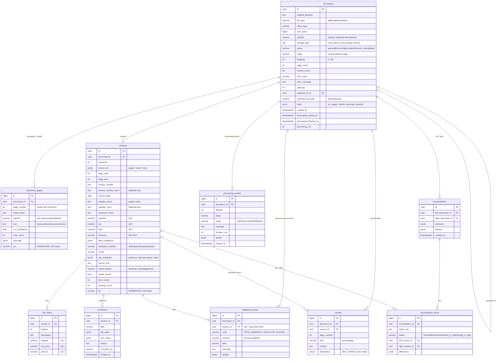

# Database schema

PostgreSQL 16 with the `vector` (pgvector) and `pg_trgm` extensions. The schema is managed by Alembic (`backend/alembic/versions/0001_initial_schema.py`); the full DDL generated from a live database is in [`schema.sql`](schema.sql).

## Design notes

* **Money** is `NUMERIC(18,2)` (quantities and unit prices `NUMERIC(18,4)`) and `Decimal` in Python: no floating-point drift in validation arithmetic. The API serializes these as JSON numbers.
* **Normalized keys** (`invoice_number_norm`: alphanumerics upper-cased; `supplier_norm`: lower-case, accents and legal suffixes such as *Ltd/Limited/GmbH* removed) power duplicate detection and cross-verification matching. They are indexed together.
* **Generated `tsvector` columns** keep keyword search in sync without triggers. Page text uses the `simple` configuration, so invoice numbers and codes are not stemmed.
* **Evidence and provenance** (`raw_extraction.evidence`, `raw_extraction.rejected`, `field_confidence`, `source_ref`, `model`) make every extracted value traceable to its source and extractor.
* **Audit trail:** every manual change and approval writes a `corrections` row (old → new, who, why). Human-corrected fields get confidence 1.0.
* **Processing history:** `processing_events` holds every stage of every attempt, so reprocessing keeps the previous attempts' history.
* **Cascade deletes:** deleting a document removes its pages, invoices, issues, events, chunks and reconciliations.
